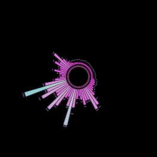

<div align="center">
  
  <h1>QSpectrum</h1>
  <p><b>Bring your cinnamon to life with a sleek, modern, native audio visualizer that turns any sound into real-time GPU-shaded motion.</b></p>
  <p>Beautiful, fluid, and dependency-free.</p>

[](https://github.com/raphaelquintao/QSpectrumCinnamon/releases/latest)
[&color=hsl(20,74%,40%))](https://github.com/raphaelquintao/QSpectrumCinnamon/releases/latest)

</div>


<div align="center">

<table align="center">
  <tr>
    <td></td>
    <td></td>
  </tr>  
  <tr>
    <td></td>
    <td></td>
  </tr>
</table>


</div>

---

QSpectrum brings the audio visualization experience Cinnamon has been missing. For too long, desktop audio visualization has been restricted to external helpers and dependency-heavy applications. QSpectrum changes that. Written entirely in native CJS, it offers a sleek, high-performance experience that integrates seamlessly on Cinnamon. It leverages hardware-accelerated GLSL shaders for fluid, cinematic visuals while managing resources with precision to keep your system responsive. More than just a visualizer, QSpectrum is a precision-engineered aesthetic engine designed to feel truly at home on your desktop.

Original Repository: [https://github.com/raphaelquintao/QSpectrumCinnamon](https://github.com/raphaelquintao/QSpectrumCinnamon)

## Installation

```shell
curl https://github.com/raphaelquintao/QSpectrumCinnamon/raw/master/install.sh -sSfL | bash 
```


## Choose Your Visual Style
QSpectrum comes with three visualization styles, each offering a different way to bring your audio to life.

### Circular
A glowing spectrum arranged around a central ring. Choose between crisp radial bars and a smooth, continuous area shape. Customize the ring, symmetry, rotation, and beat response to create anything from a subtle desktop accent to a vivid centerpiece.

### Vertical
A modern take on the classic audio spectrum. Display individual bars, a flowing filled area, or a clean waveform-like line. You can also mirror the visualization so it grows from the center.

### Advanced
Go beyond traditional spectrum bars with GPU-powered visual effects rendered using custom GLSL shaders.
- **Fire Ring** --- A vivid ring of flames and embers, with audio-reactive movement and intensity.
- **Sunset** --- A retro synthwave landscape featuring a striped sun, spectrum-shaped mountains, and a rippling reflective sea.

## Features
- **Native Performance:** Zero external dependencies; lightweight CJS implementation.
- **Three Core Styles:** Circular, Vertical, and Advanced.
- **Cinematic Shaders:** Pre-built *Fire Ring* and *Sunset* presets.
- **Theme Engine:** Eight built-in themes plus full custom color control.
- **Post-Processing Shaders:** Adjustable glow, chromatic aberration, CRT effects, heat haze, and more.
- **Multi-Instance:** Run up to 10 independent QSpectrum instances simultaneously.


## Troubleshooting
- **No visualizer showing?** Ensure GStreamer 1.x is installed with the `spectrum` element (`gst-plugins-good`).
- **Background issues?** If the background is solid, check "Show Desklet Background" in the settings.
- **CPU/RAM usage?** We manage the heap manually, but if it feels sluggish, try lowering the **Render Rate** in the settings.
- **Audio source?** QSpectrum defaults to the system's output monitor. Check your Cinnamon sound settings if you are trying to capture specific input.


## Credits & License
QSpectrum is built upon decades of mathematical insight and digital signal processing wisdom. This project stands on the shoulders of giants. Every algorithm is carefully implemented, and full attributions are available in [ATTRIBUTIONS.md](ATTRIBUTIONS.md).

QSpectrum is released under the Apache-2.0 License. See [LICENSE.txt](LICENSE.txt).

