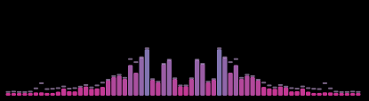
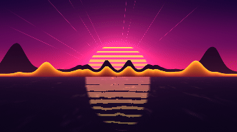
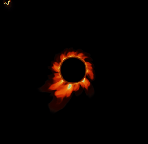

<div align="center">
  
  <h1>QSpectrum</h1>
  <p><b>Bring your Cinnamon desktop to life with a sleek, real-time audio visualizer that transforms sound into beautiful, fluid motion.</b></p>

[](https://github.com/raphaelquintao/QSpectrumCinnamon/releases/latest)
[&color=hsl(20,74%,40%))](https://github.com/raphaelquintao/QSpectrumCinnamon/releases/latest)

</div>


<div align="center">

<table align="center">
  <tr>
    <td></td>
    <td></td>
  </tr>  
  <tr>
    <td></td>
    <td></td>
  </tr>
</table>


</div>

---

QSpectrum brings real-time audio visualization directly to your Cinnamon desktop. From classic spectrum displays to vibrant circular animations and GPU-powered visual effects, it transforms system audio into a customizable visual experience.

Built natively for Cinnamon, QSpectrum runs directly within its CJS environment, leveraging GStreamer's Spectrum element for real-time frequency analysis and custom GLSL shaders for hardware-accelerated rendering. The result is a lightweight, self-contained visualizer with fluid animations and sophisticated audio-reactive graphics, without external visualizer applications or background processes.

## Visualizations

QSpectrum provides three visualization styles, each with its own rendering approach and customization options.

### Circular

A radial spectrum arranged around a central ring.

Choose between individual radial bars and a continuous area visualization. Customize symmetry, rotation, ring appearance, and beat response to control how the spectrum evolves around the center.

### Vertical

A conventional spectrum layout with multiple rendering modes.

Display individual frequency bars, a continuous filled area, or a waveform-like line. Mirrored rendering is also available, allowing the visualization to expand from its center.

### Advanced

Custom GLSL shader effects that go beyond conventional spectrum representations.

- **Fire Ring** — An audio-reactive ring of flames and particles, with continuously evolving movement and intensity.
- **Sunset** — A synthwave-inspired landscape featuring a striped sun, spectrum-shaped mountains, and a reflective, rippling sea.

## Features

- **Native Cinnamon Integration:** Runs directly in Cinnamon's CJS environment without external visualizer applications or helper processes.
- **Real-Time Audio Analysis:** Uses GStreamer's Spectrum element to extract frequency information from system audio.
- **GPU-Accelerated Rendering:** Custom GLSL shaders handle visualization and post-processing.
- **Three Visualization Styles:** Circular, Vertical, and Advanced, each with distinct rendering options.
- **Built-in Themes:** Eight predefined themes, with customizable colors.
- **Post-Processing Effects:** Adjustable glow, chromatic aberration, CRT effects, heat haze, and more.
- **Multiple Instances:** Run up to 10 independent QSpectrum desklets simultaneously.

## Installation

Install directly using the installation script:

```bash
curl -fsSL https://github.com/raphaelquintao/QSpectrumCinnamon/raw/master/install.sh | bash
```

Restart Cinnamon or refresh the desklets list if QSpectrum does not appear immediately.

## Requirements

- Cinnamon desktop environment.
- GStreamer 1.x with the `spectrum` element, provided by `gst-plugins-good`.
- OpenGL support for GLSL shader rendering.

GStreamer is part of the standard Linux multimedia ecosystem and is already available on most major desktop distributions.

## Troubleshooting

- **No visualization:** Verify that GStreamer is installed and that the `spectrum` element is available.
- **Solid background:** Check the *Show Desklet Background* option in the desklet settings.
- **Performance issues:** Reduce the *Render Rate* to decrease rendering frequency and GPU workload.
- **No audio response:** QSpectrum monitors system audio output by default. Check your Cinnamon sound settings and selected audio source.

## Credits & License

Released under the [Apache License 2.0](LICENSE.txt).


