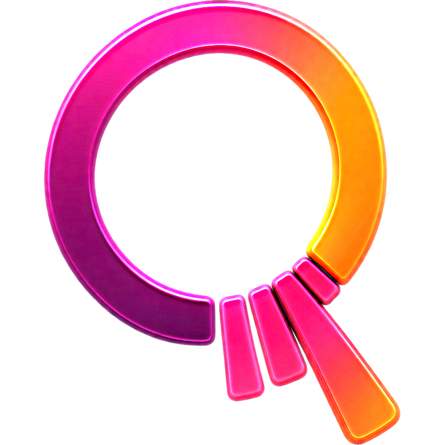
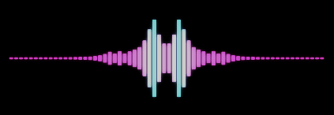

<div align="center">
  
  <h1>QSpectrum</h1>
  <p><b>Bring your desktop to life with a sleek, modern, native audio visualizer that turns any sound into real-time GPU-shaded motion.</b></p>
  <p>Beautiful, fluid, and dependency-free.</p>
</div>

| Bars | Glow | Circular |
|------|------|----------|
|  |  |  | 

---

QSpectrum brings the audio visualization experience Cinnamon has been missing. For too long, desktop audio visualization has been restricted to external helpers and dependency-heavy applications. QSpectrum changes that. Written entirely in native CJS, it offers a sleek, high-performance experience that integrates seamlessly into your workflow. It leverages hardware-accelerated GLSL shaders for fluid, cinematic visuals while managing resources with precision to keep your system responsive. More than just a visualizer, QSpectrum is a precision-engineered aesthetic engine designed to feel truly at home on your desktop.

## Choose Your Visual Style
QSpectrum comes with three visualization styles, each offering a different way to bring your audio to life.

### Circular
A glowing spectrum arranged around a central ring. Choose between crisp radial bars and a smooth, continuous area shape. Customize the ring, symmetry, rotation, and beat response to create anything from a subtle desktop accent to a vivid centerpiece.

### Vertical
A modern take on the classic audio spectrum. Display individual bars, a flowing filled area, or a clean waveform-like line. You can also mirror the visualization so it grows from the center.

### Advanced
Go beyond traditional spectrum bars with GPU-powered visual effects rendered using custom GLSL shaders.
- **Fire Ring** --- A vivid ring of flames and embers, with audio-reactive movement and intensity.
- **Sunset** --- A retro synthwave landscape featuring a striped sun, spectrum-shaped mountains, and a rippling reflective sea.

## Features
- **Native Performance:** Zero external dependencies; lightweight CJS implementation.
- **Three Core Styles:** Circular, Vertical, and Advanced.
- **Cinematic Shaders:** Pre-built *Fire Ring* and *Sunset* presets.
- **Theme Engine:** Eight built-in themes plus full custom color control.
- **Post-Processing:** Adjustable glow, chromatic aberration, CRT effects, heat haze, and more.
- **Multi-Instance:** Run up to 10 independent QSpectrum instances simultaneously.

## Installation
```bash
git clone https://github.com/raphaelquintao/qspectrumcinnamon.git
cd qspectrumcinnamon
ln -s "$PWD/files/qspectrum@quintao" ~/.local/share/cinnamon/desklets/qspectrum@quintao
```

Then, open your Cinnamon Desklet settings to add the QSpectrum desklet to your desktop.

## Troubleshooting
- **No visualizer showing?** Ensure GStreamer 1.x is installed with the `spectrum` element (`gst-plugins-good`).
- **Background issues?** If the background is solid, check "Show Desklet Background" in the settings.
- **CPU/RAM usage?** We manage the heap manually, but if it feels sluggish, try lowering the **Render Rate** in the settings.
- **Audio source?** QSpectrum defaults to the system's output monitor. Check your Cinnamon sound settings if you are trying to capture specific input.

## Configuration Reference
<details>
<summary>Click to view settings details</summary>

### General
| Setting | Description |
| --- | --- |
| **Visualizer Style** | Which renderer to use: *Circular*, *Vertical* or *Advanced*. |
| **Silence Threshold** | The noise floor (dB). Discards low-level signal noise. |
| **Render Rate** | Frames per second (default `60`). Drop to save power. |
| **Resize with Scroll** | Scale canvas size live by scrolling over the desklet. |

### Appearance
| Setting | Description |
| --- | --- |
| **Show Desklet Background** | Draws a background panel and border. |
| **Color Theme** | Choose from *Neon*, *Sunset*, *Mono*, *Matrix*, *Vaporwave*, *Cyberpunk*, *Tron*, or *Custom*. |
| **Glow Settings** | Configure Strength, Radius, and Core Boost for sampled blur effects. |
| **Shade Effects** | Apply post-effects like *Chromatic aberration*, *CRT*, *Heat haze*, *Glitch*, etc. |

### Circular
| Setting | Description |
| --- | --- |
| **Ring Canvas Size** | Side of the square canvas (px). |
| **Ring Substyle** | *Radial Bars* or *Area*. |
| **Mirror** | Repeats the spectrum 4x around the ring. |
| **Spectral Centroid Bias** | Biases rotation/speed based on audio "center of mass". |

### Vertical
| Setting | Description |
| --- | --- |
| **Canvas Width** | Width in pixels. |
| **Bars Substyle** | *Vertical Bars*, *Area*, or *Line*. |
| **Grow Bars** | Mirrors bars horizontally from the center. |

### Advanced
| Setting | Description |
| --- | --- |
| **Advanced preset** | *Fire Ring* or *Sunset*. |
| **Effect intensity** | Controls the strength of the shader output. |
| **Animation speed** | Sets the shader clock frequency. |
</details>

## Credits & License
QSpectrum is built upon decades of mathematical insight and digital signal processing wisdom. From the foundational brilliance of the Cooley-Tukey FFT to the nuanced filter designs found in CAVA, this project stands on the shoulders of giants. Every algorithm is carefully implemented, and full attributions are available in [ATTRIBUTIONS.md](ATTRIBUTIONS.md).

QSpectrum is released under the Apache-2.0 License. See [LICENSE.txt](LICENSE.txt).

